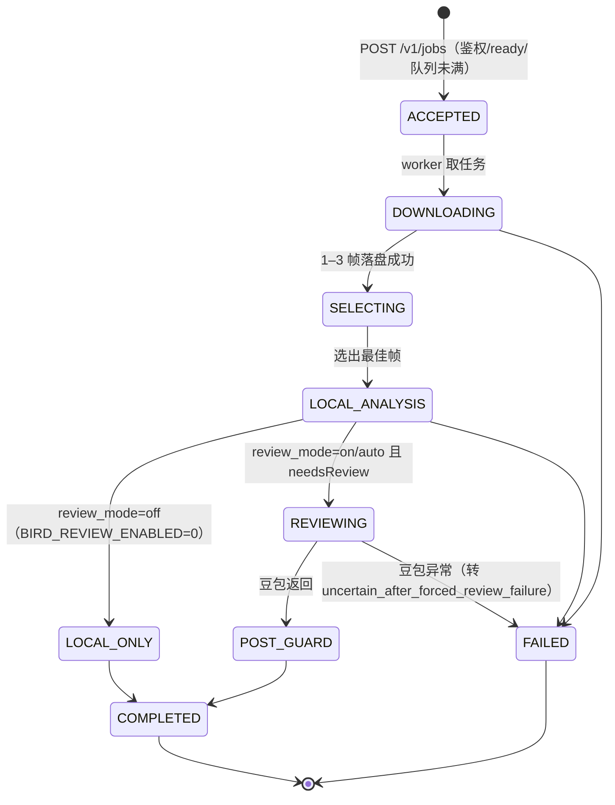

# 识别流水线状态机说明

本服务是**确定性状态机（固定 DAG）**，不是 ReAct／Agent：没有模型自主规划、没有多轮工具循环、每个事件严格只调用一次豆包。所谓"记忆"只是单个任务内的 state 对象与落盘文件，跨任务不参与推理。

## 1. 状态流转

对外可见 status：受理返回 `reviewing`，worker 执行中为 `processing`，终态为 `done`（响应体 `status=ok`）或 `error`。

## 2. 状态明细

| 状态 | 关键动作 | 驻留数据（本任务记忆） | 失败/回退 |
|---|---|---|---|
| ACCEPTED | 校验鉴权、`/health/ready`、队列容量；落盘 `request.json`，入队 | `requestId`、URL 列表、`submit`（含 `deviceId`/`eventId`/`capturedAt`/`location`）、headers | 401/503/429 |
| DOWNLOADING | 逐帧下载：SSRF 校验、≤10MB、JPEG/PNG/WebP 探测 | `paths` | 下载失败 → FAILED |
| SELECTING | 选最佳帧，确定 `bestImageIndex` 与送审帧序 | `bestImageIndex`、帧数 | — |
| LOCAL_ANALYSIS | YOLO 聚焦 → BioCLIP 全词表打分 → 3 帧 `score_mean` 融合 → 地域（默认 OFF）→ 地理先验软加分 → review 短列表 → open-set 池 → 风险判定 | `local_result`：`globalBioCLIP`/`risk`/`geographicPrior`/`frameFusion` | 模型异常 → FAILED |
| LOCAL_ONLY | 只产出本地 Top5 与性状，`decisionSource=local_only` | — | — |
| REVIEWING | `review_prepared`：open-set 单链路注入 1 个 Top5 外候选后，**一次性**调用豆包裁决 | `prepared`（含三帧图像、候选、性状） | 异常 → uncertain 报告 |
| POST_GUARD | 视觉共识守卫（`visual_consensus_guard`），必要时改写决策来源 | `doubao.review`、`audio_result` | 守卫不通过按原决策降级 |
| COMPLETED | 组装顶层 14 字段 + `report` 28 字段 + `meta`；落盘 `result.json`；可选回调 | 最终结果 | 回调失败重试（3 次） |
| FAILED | 写 `error` 字段，保留 `local` 中间态 | — | — |

## 3. 分支守卫（guards）

**是否复核**（`assess_risk`）——任一阻塞项成立即 `needsReview=true`：

- `scene_*`（场景路由非鸟）、`target_not_detected`、`detection_unreliable`（检测分 < 0.1）
- `bird_incomplete_or_clipped`（裁切边 > 1）
- `original_focus_conflict`（原图/裁剪视图 Top1 不一致）
- `taxonomy_coverage_cross_family_conflict`（可配置关闭）
- `margin_threshold_not_calibrated`、`candidate_margin_below_calibrated_threshold`

> 当前 `localDecision.marginThreshold=0.05`（20261121 批次实测标定：对例 margin p50=0.093，错例 p50=0.048），`review.defaultMode=auto`：margin ≥ 0.05 且无其他阻塞项时 `local_direct` 直通，否则触发豆包复核。质量分门禁已废弃（实测对错无区分度），`qualityScore` 仅作观测指标保留。

**复核路径内的分支**：

- 决策值：`candidate` / `genus` / `family` / `no_bird` / `reject_all`；`candidate` 的排名越界会降级为 `reject_all`。
- open-set：BioCLIP 全词表 rank 6–50 中未进短列表的最优候选注入 1 个；若豆包选择它，`decisionSource=doubao_open_set_escape_review`。
- 地理先验：仅对候选排序做 ≤0.05 cosine 软加分，从不过滤。中性回退原因：`missing_or_invalid_wgs84_location` / `distribution_asset_not_configured` / `invalid_or_unavailable_asset`（含 sha256 不匹配）/ `outside_coverage` / `ambiguous_cell_coverage` / `no_applicable_support`。
- 三帧：`multiFrame.sendAllFramesToVlm=true` 时送审必须是 3 张互不相同的帧，否则显式报错，不静默降级为单帧。

## 4. 可观测性

- 日志：`local_ready`（top5/scene）、`result_fetch`（status/bytes/waitMs/remote）、`callback_attempt_failed`。
- 落盘：`data/jobs/<日期>/<requestId>/{request.json,frame*.jpg,result.json}`。
- 响应：`meta.geographicPrior`（白名单摘要）、`meta.review`、`meta.traits`、`meta.usage`、`meta.vlmStatus`、`meta.error`。

## 5. 边界与取舍

- 不引入 LangGraph／ReAct：任务有界，动态规划无收益；单事件一次 VLM 是时延与契约的前提。
- 不引入 LangSmith：它是 LLM 应用追踪/评测平台，本服务只有一次外部模型调用且已有请求级结构化日志与落盘审计；接入还需把图片与文本外发到第三方，隐私与合规成本大于收益。若后续真要评测，优先在本地用 `data/jobs` 回放 + 离线脚本跑混淆矩阵。
